 

  

 

## 🧰 Tech Stack

 

## 🚀 Featured Projects

<table>
  <tr>
    <td width="50%" valign="top">
      <h3>🔎 <a href="https://github.com/atharvingle358/CampusFind">CampusFind</a></h3>
      A campus lost and found platform for students.  
      
    </td>
    <td width="50%" valign="top">
      <h3>🧪 <a href="https://github.com/atharvingle358/OOPCG-Exam-Preparation">OOPCG-Exam-Preparation</a></h3>
      C++ OOP and Computer Graphics practical programs with daily practice and solutions.  
      
    </td>
  </tr>
  <tr>
    <td width="50%" valign="top">
      <h3>🖥️ <a href="https://github.com/atharvingle358/OS-Practicals">OS-Practicals</a></h3>
      Operating System lab practicals using Bash shell scripting and C++.  
      
      
    </td>
    <td width="50%" valign="top">
      <h3>🌱 <a href="https://github.com/atharvingle358?tab=repositories">More on the way</a></h3>
      Always building something new. Browse all my repositories.  
      
    </td>
  </tr>
</table>

 

## 🎯 Currently

**Strengthening DSA** &nbsp;·&nbsp; **Contributing to open source (PP-MoC)** &nbsp;·&nbsp; **Looking for internships**

 

## 📊 GitHub Stats

  

## 📫 Let's Connect

 

Always learning, always building.

